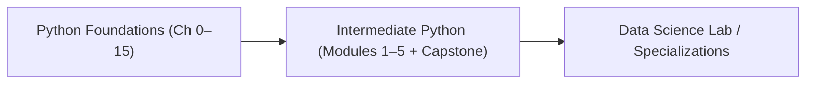

# Python Lab Version 24 — Intermediate Curriculum Audit & Architecture Plan

**Audit Date:** November 16, 2026  
**Auditor:** Principal React/TypeScript Engineer, Curriculum Architect & QA Specialist  
**Repository:** [https://github.com/Shadabur-Rahaman/python-lab](https://github.com/Shadabur-Rahaman/python-lab)  
**Live Site:** [https://shadabur-rahaman.github.io/python-lab/](https://shadabur-rahaman.github.io/python-lab/)  
**Previous Release:** Version 23 (`4da334b`)  

---

## 1. Verification of V23 Deployment

Before proceeding with Version 24 architecture, the deployment of Version 23 (`4da334b`) was verified via the official GitHub Actions API and live HTTP probe:

- **GitHub Actions Workflow Run:** `43746940737`
- **Workflow Name:** `Deploy Python Lab to GitHub Pages`
- **Head SHA:** `4da334b79d2ddabe8b1690ed11fa963cfdea60d1`
- **Status:** `completed`
- **Conclusion:** `success`
- **Created At:** `2026-11-15T18:28:20Z`
- **Live Production URL:** `https://shadabur-rahaman.github.io/python-lab/` (HTTP 200 OK)

Version 23 was successfully verified and deployed with 0 test failures and clean automated verification.

---

## 2. Audit of Existing Intermediate Content (`src/data/intermediate.ts`)

`src/data/intermediate.ts` contains three foundational advanced chapters (Chapters 13, 14, 15):

| Chapter ID | Title | Level | Core Concepts | Graded Tasks |
| :---: | :--- | :---: | :--- | :--- |
| **Chapter 13** | Transforming Collections | 2 (Intermediate) | List comprehensions, `zip(..., strict=True)`, `enumerate()`, `sorted()` with `lambda` tiebreakers | `trim-labels` (Easy)<br>`passing-scores` (Medium)<br>`sort-orders` (Challenge) |
| **Chapter 14** | Files, JSON & Exceptions | 2 (Intermediate) | `pathlib.Path`, Pyodide virtual filesystem, `json.loads`/`dumps`, narrow `try...except`, `JSONDecodeError` | `read-count` (Easy)<br>`read-names` (Medium)<br>`load-stock` (Challenge) |
| **Chapter 15** | Classes & Object State | 3 (Object-Oriented) | `class`, `__init__`, `self`, method binding, avoiding shared mutable class attributes | `make-counter` (Easy)<br>`counter-reset` (Medium)<br>`shopping-basket` (Challenge) |

### Existing 9 Intermediate Challenges Analysis

All 9 tasks in `intermediate.ts` enforce behavioral contracts rather than string matching:
- **`trim-labels`:** Function taking a list of strings, returning whitespace-trimmed strings via list comprehension. Evaluated on ordinary whitespace, blank retained strings, and empty list.
- **`passing-scores`:** Function filtering scores at or above a threshold using `[score for score in scores if score >= minimum]`. Evaluated with multiple thresholds and empty matches.
- **`sort-orders`:** Function sorting tuples by `(-priority, name)` using `sorted(..., key=lambda ...)`. Evaluated on priority ties and negative priorities.
- **`read-count`:** Function returning `int(text)` or fallback `0` when `ValueError` is raised. Evaluated on whitespace, malformed text, and signed numbers.
- **`read-names`:** Function safely decoding a JSON array of strings, validating top-level list type and element types.
- **`load-stock`:** Function decoding a JSON dictionary, validating non-negative integer counts, explicitly rejecting booleans (`bool` is a subtype of `int`).
- **`make-counter`:** Class `Counter(start)` storing `self.value = start`. Evaluated on positive, negative, and zero starting states.
- **`counter-reset`:** Class with `increment()` and `reset()` restoring initial state.
- **`shopping-basket`:** Class with independent instance list `self.items = []`, `add()`, and `count()`. Evaluated for instance isolation.

**Audit Finding:** These 9 challenges are pedagogically sound, fully tested with real Python test cases, and must be preserved completely.

---

## 3. Prerequisite Coverage Audit Across Chapters 0–15

A thorough survey of Chapters 0–15 identifies what has been taught and where students stand upon completing Foundations:

| Chapter Range | Key Competencies Acquired |
| :--- | :--- |
| **Ch 0–5 (Syntax & Basics)** | Algorithms, execution order, `print()`, variables, types (`int`, `float`, `str`, `bool`), type casting, `input()`, operators (`+`, `-`, `*`, `/`, `//`, `%`, `**`), logic (`and`, `or`, `not`). |
| **Ch 6–7 (Control Flow)** | `if`, `elif`, `else`, branching, `while` loops, bounded `for` loops with `range()`, `break`, `continue`. |
| **Ch 8–10 (Data Structures)** | String slicing and methods (`strip`, `lower`, `upper`, `replace`), lists (`append`, `pop`, indexing, slicing), tuples, dictionaries (`get`, `keys`, `values`), sets. |
| **Ch 11–12 (Functions & Projects)** | `def`, parameters, `return`, local vs global scope, composing basic programs. |
| **Ch 13–15 (Data, Files & State)** | Comprehensions, sorting with keys, `pathlib`, JSON parsing, `try...except`, classes, `__init__`, `self`. |

### The Educational Gap: What is Missing for Real-World Competence?
Foundational students understand basic syntax, but struggle with:
1. **Modules & Standard Library:** Students do not know how to break code across multiple files, leverage built-in libraries (`math`, `random`, `statistics`, `csv`, `datetime`), or handle `ImportError`/`ModuleNotFoundError`.
2. **Professional Function Design:** Basic functions in Chapter 11 only covered positional parameters. Students need default arguments (`arg=default`), keyword arguments, type annotations (`def f(x: int) -> str:`), docstrings, and clean separation of pure business logic from side effects (`print`/`input`).
3. **Iterators & Generators:** Understanding the difference between in-memory collections and lazy evaluation (`iter()`, `next()`, `yield`) is a major leap in Python fluency.
4. **Structured Tabular Data (CSV):** While Chapter 14 covered JSON, real-world data science and business automation relies on CSV. Students need to use Python's built-in `csv` module (`csv.reader`, `csv.DictReader`, `csv.writer`) without relying on heavy third-party dependencies like Pandas.
5. **Testing & Defensive Programming:** Writing independent unit tests using `assert`, testing boundary edge cases, diagnosing tracebacks, and refactoring with confidence.

---

## 4. Practice Grader Audit: False Positives & Hardcoded Answers

### Beginner Grader Audit (Chapters 0–10)
- In Chapters 0–10, 33 tasks evaluate `matchesOutput(actual, expected)`.
- *Finding:* Because introductory tasks ask beginners to write a single script that prints a specific greeting or calculation, students could theoretically pass by printing the literal result.
- *Mitigation in V24:* Intermediate challenges must NEVER rely solely on string output matching. Every intermediate challenge must define callable functions, generators, or classes evaluated against dynamic assertion suites and multi-case test runners in Pyodide.

### Intermediate Grader Audit (Chapters 13–15)
- All 9 tasks in `intermediate.ts` run dynamically generated assertions (e.g. `assert trim_labels([" a ", "b "]) == ["a", "b"]`).
- Hardcoding a single return value fails boundary checks (e.g. empty lists, negative inputs, invalid formats).
- *Verified in `tests/platform.test.mjs`:* A fake implementation returning hardcoded pass strings triggers `AssertionError` and fails the suite.

---

## 5. Architectural Design of the Intermediate Python Path

### Clear Learning Pathway Navigation


### Module Structure for Intermediate Python

```
Intermediate Python Learning Path
├── Module 1: Modules and the Python Standard Library
│   ├── Concepts: import, from...import, math, random, statistics, namespaces
│   ├── Format A (Predict): Random seed determinism and statistics.mean
│   ├── Format B (Debug): ModuleNotFoundError / math.sqr typo fix
│   └── Format C (Write): calculate_statistics(numbers) -> dict
│
├── Module 2: Writing Better Functions
│   ├── Concepts: Default arguments, keyword arguments, type hints, docstrings, pure functions
│   ├── Format A (Predict): Default argument evaluation and keyword ordering
│   ├── Format B (Debug): Mutable default argument trap (arg=[])
│   └── Format C (Write): format_invoice(client, items, discount=0.0, tax_rate=0.05)
│
├── Module 3: Iterators and Generators
│   ├── Concepts: Iterables vs Iterators, iter(), next(), yield, memory efficiency
│   ├── Format A (Predict): Stepping through a generator with next()
│   ├── Format B (Debug): StopIteration exhaustion and generator reuse error
│   └── Format C (Write): batch_records(items, batch_size) -> generator
│
├── Module 4: Structured Data with CSV
│   ├── Concepts: Built-in csv module, csv.DictReader, parsing rows into records, type cleaning
│   ├── Format A (Predict): Parsing a virtual CSV string with csv.DictReader
│   ├── Format B (Debug): Handling missing columns and whitespace in CSV headers
│   └── Format C (Write): parse_sales_csv(csv_text) -> list[dict] with computed totals
│
├── Module 5: Testing and Debugging
│   ├── Concepts: Automated unit testing, assert, edge case matrices, failure diagnostics
│   ├── Format A (Predict): Identifying which assertion fails on boundary cases
│   ├── Format B (Debug): Fixing a boundary bug revealed by failing assertions
│   └── Format C (Write): test_suite_for_palindrome(func)
│
└── Capstone Project: Student Marks Analyzer
    ├── Brief: Process classroom CSV records, validate data, compute aggregates, identify top performers
    ├── Features: Modular functions, data cleaning, statistical summaries, automated assertions
    └── Bridge: Direct springboard into Data Science without duplicating Pandas/NumPy
```

---

## 6. Verification and Integration Rules

1. **Preserve All Existing Routes:** `#/chapter/0` through `#/chapter/15` must remain completely intact.
2. **Distinct Progress Domain:** Intermediate modules will be tracked in `progress.intermediateCompleted` and `progress.intermediateSolved`, with backward-compatible schema normalization.
3. **Accessible & Responsive:** Zero horizontal scroll on 390px mobile viewports, full keyboard focus support.
4. **Automated Verification:** Full regression passes in `npm run verify:release` (38+ unit tests, 87+ Playwright tests).
